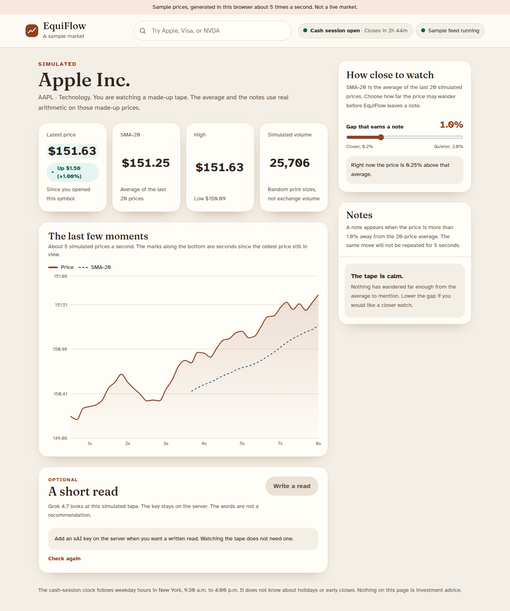
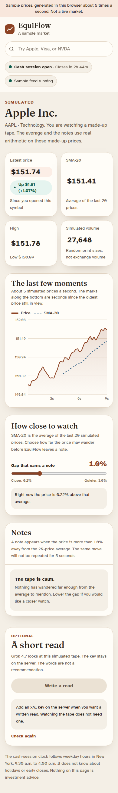
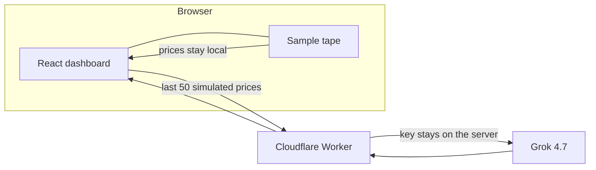

# EquiFlow

A calm place to watch a **simulated** stock tape. Prices are invented in the browser. The 20-price average, the volatility notes, and the chart are real calculations on that invented tape. An optional written read is produced by Grok, and the API key never ships to the browser.

This is a portfolio project. It is not a brokerage, a data vendor, or investment advice.





## What you can do

- Watch one of ten sample companies. The tape is a small random walk, about five prices a second.
- Read the latest price, the change since you opened that symbol, the high and low over that same stretch, and a simulated volume that is explicitly not exchange volume.
- See the SMA-20, the average of the last 20 prices, drawn as a dashed line once those 20 prices exist.
- Set how far the price may wander from that average before EquiFlow leaves a note. The gap is a percent, so a $150 name and a $300 name are treated the same way. The same move is not repeated for five seconds.
- Search the sample list by ticker, company, or sector, with the keyboard.
- Ask for a short read. Grok 4.7 describes the simulated tape. The button does nothing useful until an xAI key is configured on the server, and the dashboard does not need that key.

The cash-session clock follows weekday hours in America/New_York, 9:30 a.m. to 4:00 p.m. It does not know holidays or early closes.

## Architecture



The tape, the SMA-20, and the notes run entirely in the page. React keeps incoming prices in a ref and paints the chart and statistics together every 200ms, so a tick does not schedule its own render. At five prices a second that coalescing is modest. It is there so the screen has one steady cadence.

The only network call is optional: `POST /api/analyze`. A Vite dev server proxies `/api` to Wrangler. A deploy serves the built page and the API from the same Worker. Static assets use Workers Static Assets, with `/api/*` handled by the Worker first.

## Engineering decisions

**The model key stays on the server.** The Worker reads `XAI_API_KEY` from a Wrangler secret (`wrangler secret put XAI_API_KEY`) or, locally, from `.dev.vars`. The browser only sees `/api/analyze`. Requests are capped at 8 per minute per IP per Cloudflare location, and the body is capped at 20 KB. The rate-limit binding is approximate and is counted separately in each Cloudflare location. A public deploy of an unauthenticated Grok proxy can still spend quota. Put [Cloudflare Access](https://developers.cloudflare.com/cloudflare-one/access-controls/policies/) or a similar gate in front of it before inviting the internet.

**The written read uses Grok 4.7.** On 9 November 2026 the [models page](https://docs.x.ai/docs/models) lists Grok 4.7 as the model for chat and code. The Worker calls the OpenAI-compatible endpoint documented on the [chat completions page](https://docs.x.ai/developers/model-capabilities/legacy/chat-completions): `POST https://api.x.ai/v1/chat/completions` with `Authorization: Bearer` and `{ "model": "grok-4.7", "messages": [...], "stream": false }`. The note shown to the reader is `choices[0].message.content`. xAI labels that endpoint as legacy and recommends the Responses API for new features. This call stays on chat completions because it is one stateless note and does not need a stored conversation. Search tools are not enabled, so Grok is not looking up live prices. The models page lists a May 2026 knowledge cutoff. The model id lives in `worker/grok.ts`.

**The volatility gap is a percent of the average.** An absolute dollar gap treats a calm $150 tape and a jumpy high-priced name as the same distance. The simulator itself moves by a fraction of price, so the note uses that same idea. Sample starting prices were also brought into a round, post-split range. They are still labels for a fake tape, not quotes.

**Gains and losses are not color alone.** Up is a deep teal with an upward mark and the word “Up”. Down is a burnt orange with a downward mark and the word “Down”. The type is Atkinson Hyperlegible. Focus is a visible clay outline. The page scrolls on a phone, and the sample-data banner stays in view.

## Scripts

| Command | What it does |
| --- | --- |
| `npm run dev` | Vite on port 3000 and the Worker on port 8787 |
| `npm run dev:web` | Dashboard only. The written read will say the API is offline. |
| `npm run dev:api` | Worker only |
| `npm test` | SMA-20, volatility, session clock, search, and the analysis API |
| `npm run typecheck` | App and Worker projects |
| `npm run lint` | ESLint |
| `npm run build` | Production dashboard in `dist/` |
| `npm run check:bundle` | Fails if the built client contains an xAI key or the model endpoint |
| `npm run deploy` | `vite build` and `wrangler deploy`. Not run by CI. |

## Setup

Node 20 or newer.

```bash
npm install
cp .dev.vars.example .dev.vars
npm run dev
```

Open `http://localhost:3000`. Leave `XAI_API_KEY` empty in `.dev.vars` and the dashboard still runs. The “Write a read” button stays disabled and explains why.

To enable the read, create a key in the xAI console and put it in `.dev.vars`:

```bash
XAI_API_KEY=your-key
```

Restart `npm run dev`. The key is used by Wrangler. It is not written into the page.

### Deploy

This repository does not deploy itself.

```bash
npx wrangler login
npx wrangler secret put XAI_API_KEY
npm run deploy
```

`npm run deploy` builds the dashboard and publishes the Worker named `equiflow`, including the static files in `dist/`. Logs and traces are turned on in `wrangler.jsonc`. The compatibility date is 2026-11-08.

## Tests and CI

GitHub Actions runs typecheck, lint, test, build, and the client-bundle check on Node 22. The market math under test includes:

- SMA-20 is null until 20 prices exist, then averages those 20, then drops the oldest.
- A move inside the percent threshold stays quiet. A wider move is a spike or a drop. More than twice the threshold is a large gap.
- Notes wait out a cooldown so one swing is not repeated on every tick.
- The weekday cash-session clock, including a Sunday, a morning open, and a Friday close.

## Limitations

- Prices, volume, and the ten-name list are simulated. There is no exchange feed, no WebSocket, and no Redis.
- The chart keeps a few minutes of prices. High, low, and volume reset when you pick another symbol, and they start over on refresh.
- The session clock ignores market holidays and early closes.
- Analysis sends the simulated prices you are already looking at to xAI when you press the button. It is a description, not a forecast, and not advice. Grok is not given a search tool, so it cannot check a live quote.
- The analysis route is unauthenticated. The rate limit is per location and can be exceeded while counts catch up. Do not put a production key behind a public URL without an additional gate.
- `grok-4.7` can be renamed or retired by xAI. The chat completions endpoint this app uses is documented as a legacy API.

## License

[MIT](LICENSE)
